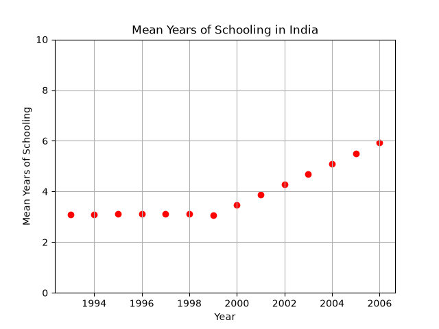
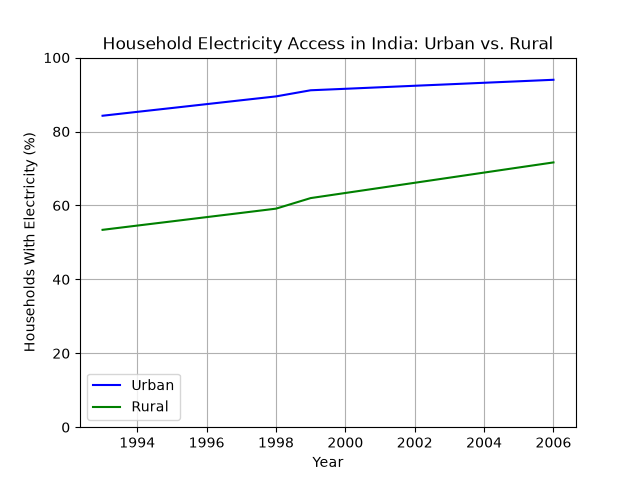

# India Female Education Analysis
A data analysis project exploring how education in India changed over time and how rural and urban areas differ in access to technology.

### Research Question
How has schooling in India changed from 1993 to 2006, and how do rural and urban households differ in access to electricity?

### Graphs
#### 1. Mean Years of Schooling in India (1993-2006)
 

 
This scatterplot shows the year on the x-axis and the mean years of schooling on the y-axis. Each dot is one year of data. The dots climb steadily upward, rising from about 3.1 years in 1993 to about 5.9 years in 2006. This means the average person in India was getting almost twice as much schooling by the end of the period.
 
#### 2. Household Electricity Access: Urban vs. Rural
 

 
This line graph shows the percentage of households with electricity, with one line for urban areas and one for rural areas. The rural line stays below the urban line, which means rural households had less access to electricity. In 1993, about 84% of urban households had electricity compared with about 54% of rural households. By 2006, those numbers were about 93% and 75%.

### Findings
Schooling in India rose from about 3.1 to 5.9 years between 1993 and 2006, and rural households had less electricity access than urban ones. However, this data doesn't split education by rural and urban areas, so it can't show what causes the gap.

### Limitations
* The data ends in 2006, so it does not describe India today.
* The dataset does not break education down by rural vs. urban, so this project can't directly show what causes the rural/urban education gap. Electricity access is used as one example of a rural/urban difference in technology.
* The values change in very small, even steps from year to year, so they may be estimates rather than exact survey results.

### How to Run it Yourself
1. Make sure `main.py` and `livwell135.csv` are in the same folder.
2. Install the required libraries by typing this in the terminal: `pip install pandas matplotlib`
3. Run the program by typing this in the terminal: `python main.py`
4. Follow the prompts in the terminal and press Enter whenever it says "Press enter to see...".

### Built With
* Python
* pandas
* matplotlib

### Dataset
`livwell135.csv` covers India from 1993 to 2006.

### P.S.
*This project is built as part of Girls Who Code's Data Science for Good Course*